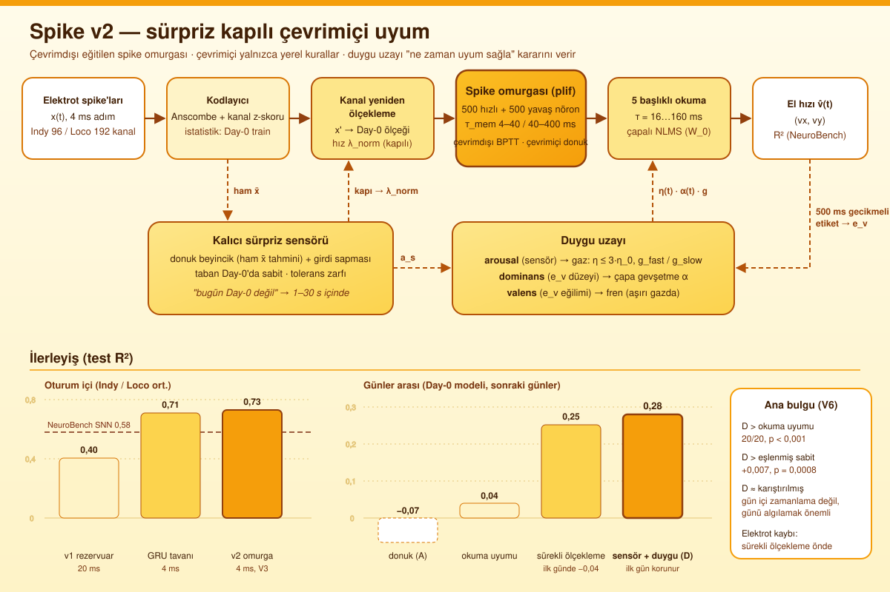

# Spike — sürpriz kapılı çevrimiçi uyum yapan spike'lı nöral dekoder

Maymun motor korteksinden kaydedilen spike'lardan el hızını çözen, **çevrimdışı eğitilmiş bir spike'lı ağ** ve onun üstünde **yalnızca yerel kurallarla** çevrimiçi uyum sağlayan bloklar: beyincik, duygu uzayı ve çapalı okuma. Veri: NeuroBench Primate Reaching (Indy, Loco).



## Hedefler

| Hedef | Ölçüt | Durum |
|---|---|---|
| Oturum içi çözümleme | NeuroBench test R² ≥ 0,65–0,70 | ✅ Indy 0,750 / Loco 0,710 (NeuroBench SNN 0,593 / 0,568) |
| Günler arası kaymaya uyum | Day-0'da eğitilen model sonraki günlerde çalışsın; etiketler 500 ms gecikmeli | ◐ Donuk model −0,07 → 0,28 |
| Elektrot kaybına dayanıklılık | 20 kanal ölünce hızlı toparlanma | ◐ Sürekli ölçekleme 11 s; duygulu sistem 17,5 s |
| Araştırma sorusu | Sürpriz / duygu kapılı uyum, aynı ortalama hızdaki sabit kuraldan (B) ve zamanlaması karıştırılmış kuraldan (C) iyi mi? | D > B ✅, D > P ✅ (küçük), D > C ✗ |
| Biyolojik kısıt | Çevrimiçi gradyan yok; omurga donuk; yalnız yerel kurallar (NLMS, homeostaz) | ✅ (ARCHITECTURE.md §12, KV1–KV8) |

## Neler denendi

### Kötü sonuç verenler

| Deneme | Sonuç | Neden |
|---|---|---|
| v1: sabit LIF rezervuarı + yerel okuma | Oturum içi 0,44 / 0,37 | Sabit rezervuarın temsili doğrusal okumaya yetmiyor; aynı ızgarada GRU 0,74 / 0,69 (KR-033) |
| v1: duygu / regülatörlerle τ, g, η ayarı | Kontrolü geçmedi; Loco'da −0,08 | Uzun τ'ya kayma yıkıcı; kapılı η eşlenmiş η'yı geçmedi (KR-028–032) |
| Günler arası, yalnız okuma uyumu (B) | Day-k 0,04 | Kayma girişte (kanal ölçeği / kimliği); okuma bozuk temsili düzeltemiyor |
| Duygu-kapılı W_in plastisitesi | Okuma uyumunu geçmedi; büyük adımda çöküyor (−0,93) | 500 ms gecikmeli hata girişi yeniden eşlemek için fazla gürültülü (KR-045) |
| Kapalı döngü duygu-kapılı ölçekleme | Day-k 0,11 < eşlenmiş sabit 0,12 | Ölçek düzelince sürpriz sönüyor, uyum duruyor (KR-046) |
| İç arousal (beyincik + başlık uyuşmazlığı) | Day-k 0,19 (D 0,28) | Başlık uyuşmazlığı hareketi izliyor ve kaymada düşüyor; arousal ilk günde daha yüksek (KR-047) |
| Valens freni (ölçülü öğrenme hızında) | −0,05 | Valens uzanma hareketlerinin gürültüsünü izliyor; fren yeni günü öğrenmeyi geri çekiyor |
| Sabit yüksek öğrenme hızı (10·η_0) | Day-k −0,35; 30× ıraksıyor | Gecikmeli NLMS 3×'in üstünde kararsız |

### Umut verici olanlar

| Deneme | Sonuç | Neden çalıştı |
|---|---|---|
| Eğitilebilir spike omurgası (plif, hızlı / yavaş alt-popülasyon) | Oturum içi 0,75 / 0,70 (v1'in ~2 katı) | Surrogate gradyanla çevrimdışı BPTT; çoklu oturum ön-eğitimi + Day-0 ince ayarı (KR-039, KR-042) |
| Etiketsiz kanal yeniden ölçekleme | Day-k 0,02 → 0,25 | Kaymanın büyük kısmı kanal ölçeği; girdiyi Day-0 ölçeğine geri çekmek temsili kurtarıyor (KR-045) |
| Kalıcı sürpriz sensörü | İlk gün korunuyor (0,775; sürekli ölçeklemede 0,738) | Ham hedefli donuk beyincik + girdi sapması, sabit Day-0 tabanı: yalnız gerçekten yeni günde açılıyor (KR-046) |
| Duygu = "ne zaman uyum sağla" anahtarı (v2-D) | Day-k **0,279**; B, P, Pg, Pm3 ve R5'ten iyi | Sensör açılınca okuma gazı (≤ 3·η_0) ve çapa gevşetme birlikte açılıyor (KR-047, KR-048) |
| Valens freni, aşırı gazda | 10·η_0'da 0,12 → 0,20 | Fren kararsız öğrenmeyi durduruyor: güvenlik ağı |
| Sürekli ölçekleme, elektrot kaybında | Kayıp sonrası 0,652, toparlanma 11 s | Ölü kanal varyansını kaybedince kendi ortalamasına iner ve nötrleşir |

### Literatürü geçtiğimiz yerler ve nasıl

| Karşılaştırma | Literatür | Bu çalışma | Farklı yapılan |
|---|---|---|---|
| NeuroBench Primate Reaching, SNN (oturum içi) | Indy 0,593 / Loco 0,568 (arXiv 2304.04640) | **0,750 / 0,710** (test, 5 seed) | 4 ms çözünürlükte eğitilen omurga; 500 hızlı + 500 yavaş nöron (τ 4–400 ms); 5 zaman ölçekli okuma (16–160 ms); çoklu oturum ön-eğitimi; CUDA Graph ile 4 ms'de tam BPTT (KR-038) |
| 4 ms GRU tavanı (kendi ölçümümüz) | Val 0,714 / 0,571 | plif 0,769 / 0,658 (val, tek oturum) | Spike'a geçmek kaybettirmedi; alt-popülasyon zaman ölçekleri GRU'dan iyi |
| Sabit kurallı çevrimiçi uyum | Okuma NLMS: Day-k 0,04 | Duygulu uyum: 0,28 | Uyumun girişte yapılması (yeniden ölçekleme) ve "ne zaman" kararının sürprizden gelmesi |

Not: NeuroBench sonuçları 75/25 bölmeyle raporlanmıştır; biz NeuroBench kodunun 80/10/10 bölmesini kullanıyoruz (KR-035). Karşılaştırma yaklaşıktır.

## Danışmanla konuşulacak açık sorular

| Sorun | Gözlem | Olası yön |
|---|---|---|
| Tespit gecikmesi | Indy 0131'de sensör ~30 s geç açılıyor (D 0,47, R5 0,60) | Hızlı değişim noktası testleri (CUSUM, Bayesçi değişim noktası); geçmiş günlerin ölçek istatistiklerinden önsel |
| Kanal kimliği kayması | Indy 0630: tüm yöntemler ≤ 0,14 | Gizil uzay hizalama (manifold alignment: Degenhart 2020, NoMAD 2022, ADAN 2019); kanal permütasyonu / eşleme |
| Elektrot kaybı | Sensörlü kapı sürekli ölçeklemenin gerisinde | Kanal başına (ölü kanal) dedektör; hibrit: kayıpta anında ölçekleme |
| Gün içi zamanlama | D ≈ C: duygunun anlık zamanlaması katkısız | Etiket gecikmesi kısaltılırsa (ör. 100 ms) zamanlama önem kazanır mı? |
| Ateşleme oranı | Loco 0,016 (homeostatik bant 0,02–0,08 altında) | Eğitimde homeostaz kaybının ağırlığı ya da hedefi |

## Kurulum ve çalıştırma

```bash
uv sync
uv run pytest tests/v2 tests/test_invariants.py
uv run python experiments/v2_v6.py --config configs/v2_v6.yaml --runs <v3 koşu klasörleri> --split val
uv run python scripts/make_tables_v2.py --runs <v6 koşu klasörleri> --out runs/v6_summary
```

## Belgeler

| Dosya | İçerik |
|---|---|
| [ARCHITECTURE.md](ARCHITECTURE.md) | Kurallar (v2: §12, KV1–KV8), denklemler, hiperparametreler |
| [docs/PhasesV2.md](docs/PhasesV2.md) | v2 fazları V0–V6 ve sonuç satırları |
| [docs/Desicion.md](docs/Desicion.md) | Karar kayıtları KR-001 … KR-048 (her denemenin sayıları ve gerekçesi) |
| [docs/v6_results.md](docs/v6_results.md) | V6 test tabloları ve Wilcoxon karşılaştırmaları |
| [docs/State.md](docs/State.md) | Günlük |
| `docs/figures/` | Mimari, duygu izleri, elektrot kaybı toparlanma eğrileri |
